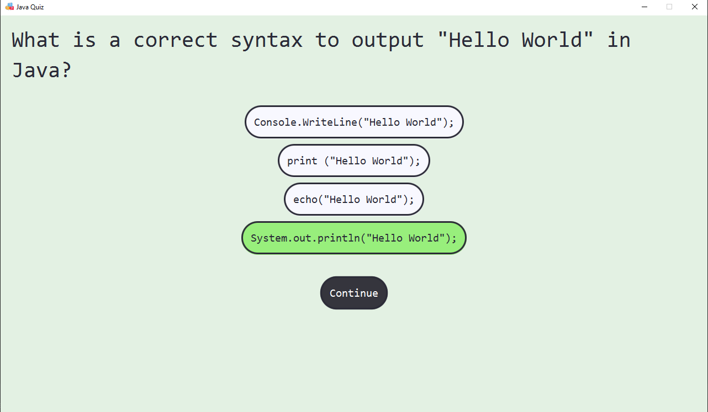

# Quiz game

A very simple quiz application with questions read from a file.

## Build requirements

Install a Java 25 JDK and Apache Maven 3.9 or newer.

There are two ways to run the application:

### Terminal

Build and run the terminal quiz from the repository root with:

```shell
mvn -Pbackend clean package
java -cp target/classes application.QuizConsole
```

Enter your answers in the terminal.


### JavaFX Application

Build and launch the desktop application from the repository root with:

```shell
mvn -Pdesktop clean package
mvn javafx:run
```

This configures the JavaFX runtime modules required by the application. Answer multiple-choice questions by selecting an
option, or type a written answer in the input box and press submit.



Correct answers turn green. Incorrect answers turn red, and the correct answer is shown in green or displayed below the
input field.

## Make your own quiz file

See [`src/main/resources/javaQuestions.txt`](src/main/resources/javaQuestions.txt) for an example.
The sample quiz is packaged with the application and loaded as a classpath resource, so launching the built app does not
depend on the repository working directory.
The first line is the quiz title. Add one question per line, separating fields with `|` (so this character cannot appear
inside a question or answer):

- Question type: `w` for written answers or `m` for multiple choice.
- Question text.
- Correct answer.
- For multiple-choice questions, any additional incorrect options.

Multiple-choice options are displayed in a random order during the quiz.
