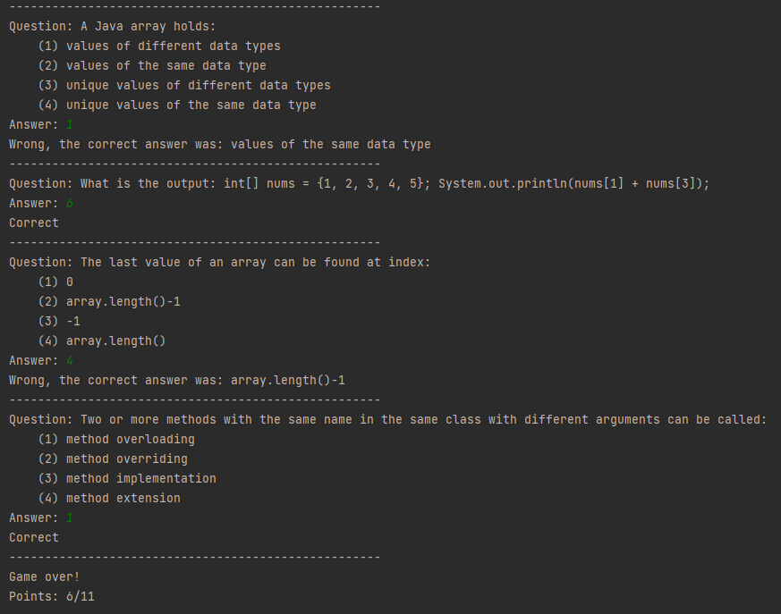

# Quiz game

A very simple quiz application with questions read from a file.

## Build requirements

Install a Java 25 JDK, Apache Maven 3.9 or newer, and Node.js 20.19 or newer for the React client.

Build the Spring Boot application from the repository root:

### Terminal

Build and run the terminal quiz from the repository root with:

```shell
mvn clean package
java -cp target/classes application.QuizConsole
```

Enter your answers in the terminal.



## HTTP API

The Spring Boot REST backend exposes the game flow under `/api/v1`. Build and start it from the repository root:

```shell
mvn clean package
java -jar target/quiz-game-1.0.1.jar
```

The server listens on port `8080` by default. Set `SERVER_PORT` to choose another port.
For local development, use `mvn spring-boot:run`.

## React application

The React client uses the REST API and runs on Vite's development server. Start the backend, then run these commands in a
second terminal:

```shell
cd frontend
npm install
npm run dev
```

Open the URL printed by Vite. The client proxies `/api` requests to the backend at `http://localhost:8080`.

Example request to start a game:

```shell
curl -X POST http://localhost:8080/api/v1/games \
  -H "Content-Type: application/json" \
  -d '{"quiz":"javaQuestions.txt"}'
```

The server returns the created game identifier and the current question without including the correct answer. Answer
validation happens on the server, and subsequent answer requests return either the next question or the final score.

## Make your own quiz file

See [`src/main/resources/javaQuestions.txt`](src/main/resources/javaQuestions.txt) for an example.
The sample quiz is packaged with the application and loaded as a classpath resource, so launching the built app does not
depend on the repository working directory.
The first line is the quiz title. Add one question per line, separating fields with `|` (so this character cannot appear
inside a question or answer):

- Question type: `w` for written answers or `m` for multiple choice.
- Question text.
- Correct answer.
- For multiple-choice questions, any additional incorrect options.

Multiple-choice options are displayed in a random order during the quiz.
